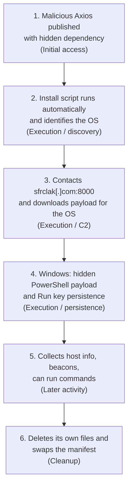

# Mitigating the Axios npm supply chain compromise

## <u>students</u>
- Matan Elgrissi [GitHub](https://github.com/SZ-io)
- Or Simovich  [GitHub](https://github.com/orsimo1234)

## Source
 
- **Title:** Mitigating the Axios npm supply chain compromise
- **Publisher:** Microsoft Security Blog (Microsoft Threat Intelligence and Microsoft Defender Security Research Team)
- **Date:** April 1, 2026 (last modified April 16, 2026)
- **URL:** https://www.microsoft.com/en-us/security/blog/2026/04/01/mitigating-the-axios-npm-supply-chain-compromise/

## 1. Attack summary
 
On March 31, 2026, two malicious versions of Axios, a widely used JavaScript HTTP library, were published to the npm registry (1.14.1 and 0.30.4). The Axios code itself was unchanged. The attackers added one hidden dependency, `plain-crypto-js` 4.2.1, which ran an install script automatically whenever a developer or build pipeline installed or updated Axios. The affected environments were developer machines and CI/CD systems running macOS, Windows or Linux. The script identified the operating system, contacted an attacker-controlled server, and downloaded a second-stage payload for that system. On Windows, the payload was a PowerShell-based remote access tool that persisted through a registry Run key, collected host information, beaconed to the server and could run commands. Afterward, the loader deleted its own files and replaced the package manifest so the install hook disappeared. Microsoft attributes the activity to the North Korean actor Sapphire Sleet. The report does not confirm the goal of this specific incident or whether any data was stolen.

# 2. Behaviors supported by the report:

## Behaviors
 
| # | Behavior |
|---|----------|
| 1 | Malicious Axios versions (1.14.1, 0.30.4) are published with a hidden extra dependency, `plain-crypto-js` 4.2.1 |
| 2 | The dependency's install script (`node setup.js`) runs automatically on install and identifies the operating system |
| 3 | The script contacts the attacker's server (`sfrclak[.]com:8000`) and downloads a payload for that OS |
| 4 | Windows: a hidden PowerShell payload runs and a Run registry key (`MicrosoftUpdate`) is created for persistence |
| 5 | The Windows tool collects host information, beacons to the server and can run commands |
| 6 | The loader deletes its own files and swaps the manifest so the install hook disappears |
 
 
## 3. Attack flow
 
 

 
## 2. Mapping table
 
| # | Observed behavior | ATT&CK tactic | Technique / ID | Evidence and mapping rationale | SOC telemetry / investigation |
|---|-------------------|---------------|----------------|--------------------------------|-------------------------------|
| 1 | Malicious Axios versions published with a hidden dependency | Initial Access | Compromise Software Dependencies and Development Tools (T1195.001) | The report says Axios code was unchanged and only the manifest added the malicious dependency. ATT&CK names npm packages for this technique. Not mapped to Valid Accounts (T1078): the report does not say how publishing access was obtained. | Package inventory, lockfile and commit history |
| 2 | Install script runs automatically and identifies the OS | Execution Discovery | JavaScript (T1059.007) System Information Discovery (T1082) | The postinstall hook ran `node setup.js` with no user action. The script identified the OS to choose a payload. | See SOC investigation |
| 3 | Contacts the C2 server and downloads a payload for the OS | Command and Control | Web Protocols (T1071.001) Ingress Tool Transfer (T1105) Non-Standard Port (T1571) | HTTP POST requests to `sfrclak[.]com` carried an OS identifier, and the response was run as the payload. Port 8000 is the report's C2 port. T1571 is lower confidence because port 8000 is common in development. | See SOC investigation |
| 4 | Windows: hidden PowerShell payload and Run key persistence | Execution Stealth Persistence | Visual Basic (T1059.005) PowerShell (T1059.001) Hidden Window (T1564.003) Rename Legitimate Utilities (T1036.003) Registry Run Keys / Startup Folder (T1547.001) | A VBScript stager ran through `cscript`, the PowerShell payload ran in a hidden window, PowerShell was copied to `%PROGRAMDATA%\wt.exe` (Microsoft calls this masquerading), and a `MicrosoftUpdate` value was added under the HKCU Run key. | See SOC investigation |
| 5 | Windows tool collects host info, beacons and can run commands | Command and Control Discovery Execution Stealth | Web Protocols (T1071.001) System Information Discovery (T1082) PowerShell (T1059.001) Reflective Code Loading (T1620) | The tool beacons with periodic encoded HTTP POSTs, collects OS version, boot time and hardware data, can run arbitrary PowerShell, and can inject binaries into memory. T1620 is lower confidence (see the uncertain mapping below). | Network logs and EDR process telemetry |
| 6 | Loader deletes its own files and swaps the manifest | Stealth | File Deletion (T1070.004) | The installer removes `setup.js` and the `package.json` that held the hook. Renaming `package.md` to `package.json` is described but not mapped, because no technique clearly fits. | Install-time logs, file deletion events, package integrity check |
# 5. SOC investigation:

## Behavior : Install script runs automatically (T1059.007, T1082)
 
- **Telemetry:** Process creation / EDR logs (`npm` → `node setup.js`), software inventory (malicious `axios` or `plain-crypto-js` versions), CI/CD and `npm install` logs.
- **Tier 1:** Check whether a listed malicious package version is present and whether the process chain runs from `node_modules/plain-crypto-js`. Escalate on a match.
- **Tier 2:** Find when and where it was installed (lockfile, commit history), what the process did next, and which other hosts and pipelines pulled the same versions. Isolate hosts and rotate secrets.
- **Not proof alone:** Many legitimate packages run install scripts.
## Behavior : Contacts the C2 server, downloads a payload (T1071.001, T1105, T1571)
 
- **Telemetry:** Proxy, firewall and DNS logs, and EDR network events, for `sfrclak[.]com:8000`.
- **Tier 1:** Match the destination against the report's indicators (the report lists the IP as both .73 and .72, so check both) and identify which process connected. Block and escalate.
- **Tier 2:** List every host that contacted the domain, match the timing to the install, and find which payload followed and whether it ran.
- **Not proof alone:** Port 8000 is common in development, so the destination and the process behind the connection matter more.
## Behavior : Windows PowerShell payload and Run key (T1059.001, T1059.005, T1564.003, T1036.003, T1547.001)
 
- **Telemetry:** Process creation with command lines (`node` → `cscript` → `powershell`, hidden window), PowerShell script block logging, registry events for the `MicrosoftUpdate` Run key, and file creation for `%PROGRAMDATA%\wt.exe`.
- **Tier 1:** Check whether PowerShell was launched by `node`, whether the Run key points outside Microsoft paths, and whether `wt.exe` is really a copy of PowerShell. Escalate on a match.
- **Tier 2:** Decode the script, confirm persistence survives a reboot, build the full process timeline, and look for follow-on commands. Isolate the host and rebuild if needed.
- **Not proof alone:** Hidden PowerShell and Run keys are also used by legitimate installers.

## 6. Uncertain mapping (put at the end)
 
**Behavior 5: in-memory loading of binaries**
 
- **Mapped:** Reflective Code Loading (T1620).
- **Alternative:** Process Injection (T1055).
- **Why it is uncertain:** The report says the Windows tool can "inject additional binary payloads directly into memory." That could mean it loads code inside its own process (T1620) or injects code into a different running process (T1055). The report does not say which.
- **Evidence needed to resolve it:** Analysis of the tool's code or API calls, or EDR telemetry, showing whether it opens another process and writes code into it (points to T1055) or only allocates and runs code in its own process (points to T1620). If another process is targeted, map T1055 instead of, or in addition to, T1620.
 
