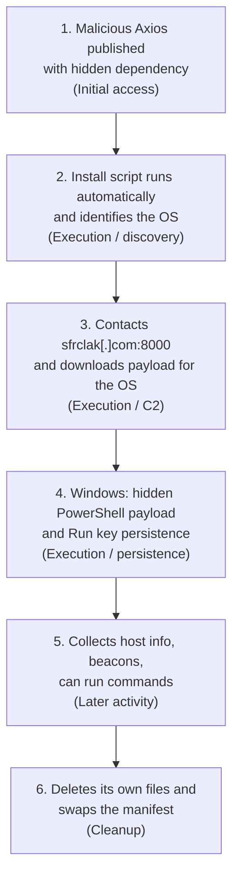

# Mitigating the Axios npm supply chain compromise

## Source
 
- **Title:** Mitigating the Axios npm supply chain compromise
- **Publisher:** Microsoft Security Blog (Microsoft Threat Intelligence and Microsoft Defender Security Research Team)
- **Date:** April 1, 2026 (last modified April 16, 2026)
- **URL:** https://www.microsoft.com/en-us/security/blog/2026/04/01/mitigating-the-axios-npm-supply-chain-compromise/

## <u>students</u>
- Matan Elgrissi
- Or Simovich
# Behaviors supported by the report:

## Behaviors
 
| # | Behavior |
|---|----------|
| 1 | Malicious Axios versions (1.14.1, 0.30.4) are published with a hidden extra dependency, `plain-crypto-js` 4.2.1 |
| 2 | The dependency's install script (`node setup.js`) runs automatically on install and identifies the operating system |
| 3 | The script contacts the attacker's server (`sfrclak[.]com:8000`) and downloads a payload for that OS |
| 4 | Windows: a hidden PowerShell payload runs and a Run registry key (`MicrosoftUpdate`) is created for persistence |
| 5 | The Windows tool collects host information, beacons to the server and can run commands |
| 6 | The loader deletes its own files and swaps the manifest so the install hook disappears |
 
 
## Attack flow
 
 

 
# ATT&CK Tactics and Techniques (Axios npm compromise)
 
**1. Malicious Axios published with hidden dependency:**
- Initial Access: [T1195.001](https://attack.mitre.org/techniques/T1195/001/) - Supply Chain Compromise: Compromise Software Dependencies and Development Tools

**2. Install script runs automatically and identifies the OS:**
- Execution: [T1059.007](https://attack.mitre.org/techniques/T1059/007/) - Command and Scripting Interpreter: JavaScript
- Discovery: [T1082](https://attack.mitre.org/techniques/T1082/) - System Information Discovery

**3. Contacts sfrclak[.]com:8000 and downloads payload for the OS:**
- Command and Control: [T1071.001](https://attack.mitre.org/techniques/T1071/001/) - Application Layer Protocol: Web Protocols
- Command and Control: [T1105](https://attack.mitre.org/techniques/T1105/) - Ingress Tool Transfer
- Command and Control: [T1571](https://attack.mitre.org/techniques/T1571/) - Non-Standard Port (lower confidence)

**4. Windows: hidden PowerShell payload and Run key persistence:**
- Execution: [T1059.005](https://attack.mitre.org/techniques/T1059/005/) - Command and Scripting Interpreter: Visual Basic
- Execution: [T1059.001](https://attack.mitre.org/techniques/T1059/001/) - Command and Scripting Interpreter: PowerShell
- Stealth: [T1564.003](https://attack.mitre.org/techniques/T1564/003/) - Hide Artifacts: Hidden Window
- Stealth: [T1036.003](https://attack.mitre.org/techniques/T1036/003/) - Masquerading: Rename Legitimate Utilities
- Persistence: [T1547.001](https://attack.mitre.org/techniques/T1547/001/) - Boot or Logon Autostart Execution: Registry Run Keys / Startup Folder

**5. Collects host info, beacons, can run commands:**
- Command and Control: [T1071.001](https://attack.mitre.org/techniques/T1071/001/) - Application Layer Protocol: Web Protocols
- Discovery: [T1082](https://attack.mitre.org/techniques/T1082/) - System Information Discovery
- Execution: [T1059.001](https://attack.mitre.org/techniques/T1059/001/) - Command and Scripting Interpreter: PowerShell
- Stealth: [T1620](https://attack.mitre.org/techniques/T1620/) - Reflective Code Loading (lower confidence; could be T1055 Process Injection)

**6. Deletes its own files and swaps the manifest:**
- Stealth: [T1070.004](https://attack.mitre.org/techniques/T1070/004/) - Indicator Removal: File Deletion

# SOC investigation:

## Behavior : Install script runs automatically (T1059.007, T1082)
 
- **Telemetry:** Process creation / EDR logs (`npm` → `node setup.js`), software inventory (malicious `axios` or `plain-crypto-js` versions), CI/CD and `npm install` logs.
- **Tier 1:** Check whether a listed malicious package version is present and whether the process chain runs from `node_modules/plain-crypto-js`. Escalate on a match.
- **Tier 2:** Find when and where it was installed (lockfile, commit history), what the process did next, and which other hosts and pipelines pulled the same versions. Isolate hosts and rotate secrets.
- **Not proof alone:** Many legitimate packages run install scripts.
## Behavior : Contacts the C2 server, downloads a payload (T1071.001, T1105, T1571)
 
- **Telemetry:** Proxy, firewall and DNS logs, and EDR network events, for `sfrclak[.]com:8000`.
- **Tier 1:** Match the destination against the report's indicators (the report lists the IP as both .73 and .72, so check both) and identify which process connected. Block and escalate.
- **Tier 2:** List every host that contacted the domain, match the timing to the install, and find which payload followed and whether it ran.
- **Not proof alone:** Port 8000 is common in development, so the destination and the process behind the connection matter more.
## Behavior : Windows PowerShell payload and Run key (T1059.001, T1059.005, T1564.003, T1036.003, T1547.001)
 
- **Telemetry:** Process creation with command lines (`node` → `cscript` → `powershell`, hidden window), PowerShell script block logging, registry events for the `MicrosoftUpdate` Run key, and file creation for `%PROGRAMDATA%\wt.exe`.
- **Tier 1:** Check whether PowerShell was launched by `node`, whether the Run key points outside Microsoft paths, and whether `wt.exe` is really a copy of PowerShell. Escalate on a match.
- **Tier 2:** Decode the script, confirm persistence survives a reboot, build the full process timeline, and look for follow-on commands. Isolate the host and rebuild if needed.
- **Not proof alone:** Hidden PowerShell and Run keys are also used by legitimate installers.
