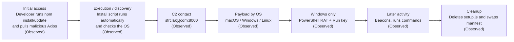

## Mitigating the Axios npm supply chain compromise
# Source
 
- **Title:** Mitigating the Axios npm supply chain compromise
- **Publisher:** Microsoft Security Blog (Microsoft Threat Intelligence and Microsoft Defender Security Research Team)
- **Date:** April 1, 2026 (last modified April 16, 2026)
- **URL:** https://www.microsoft.com/en-us/security/blog/2026/04/01/mitigating-the-axios-npm-supply-chain-compromise/

## <u>students</u>
- Matan Elgrissi
- Or Simovich
# Behaviors supported by the report:

## Behaviors
 
| # | Behavior | Status |
|---|----------|--------|
| 1 | Malicious Axios versions (1.14.1, 0.30.4) are published with a hidden extra dependency, `plain-crypto-js` 4.2.1 | Observed |
| 2 | The dependency's install script (`node setup.js`) runs automatically on install and identifies the operating system | Observed |
| 3 | The script contacts the attacker's server (`sfrclak[.]com:8000`) and downloads a payload for that OS | Observed |
| 4 | Windows: a hidden PowerShell payload runs and a Run registry key (`MicrosoftUpdate`) is created for persistence | Observed |
| 5 | The Windows tool collects host information, beacons to the server and can run commands | Observed |
| 6 | The loader deletes its own files and swaps the manifest so the install hook disappears | Observed |

## Attack flow
 

 
Plain-text version:
 
```
Initial access -> Execution/discovery -> C2 contact -> Payload by OS
 (npm install)     (install script,       (sfrclak     (macOS/Windows/Linux)
                    OS check)              .com:8000)         |
                                                              v
                      Cleanup  <-  Beacons/commands  <-  Windows: PowerShell RAT
                   (delete files,     (host info,          + Run key
                    swap manifest)     remote commands)
```
